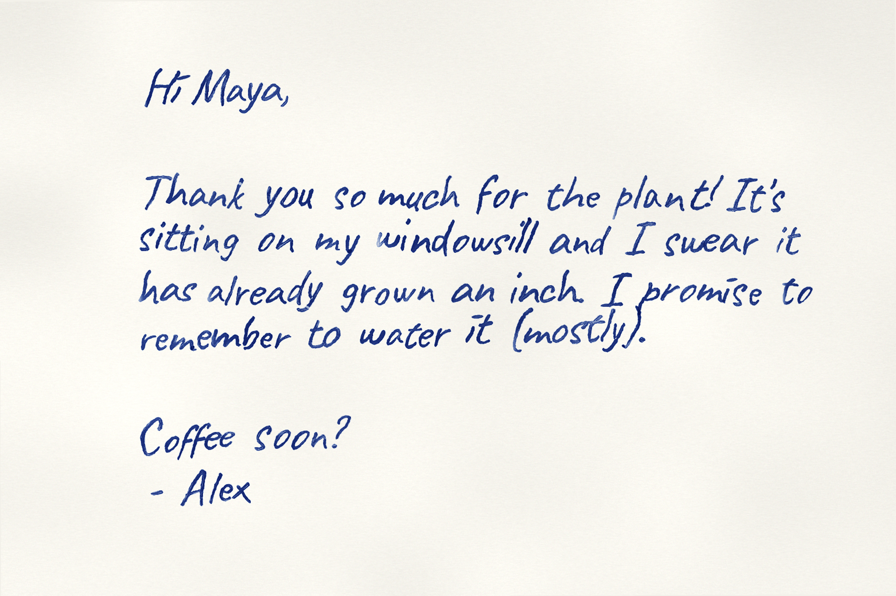

# handwriter



Turns text into handwriting that looks like a real person wrote it with a real pen, not like a font.

Handwriting fonts look fake because every "a" is identical, every line is perfectly straight, and the ink is a flat, perfect fill. handwriter uses a font only as a skeleton. It writes as one consistent but imperfect **writer**, using a physically modelled **pen**.

## The writer

Variation happens in three layers, the same way it does in real handwriting:

| Layer | What varies |
|---|---|
| **Personal habits** (fixed for the whole document) | 2 personal variants of every letter, used in a habitual ratio · where the i/j dots land (usually right and high), and whether they're dots or little flicks · words trailing off (last letter smaller, drifting up or down) · first letter slightly bigger |
| **Slow drift** (per line) | baseline wander, line tilt, size and slant drift · fatigue: messier toward the bottom of the page |
| **Instance noise** (per letter) | small warp, scale, rotation, spacing jitter · hand tremor that roughens stroke edges |

It also crams a word in near the margin instead of wrapping when the word *almost* fits, and leaves a ragged right edge. Crossed-out typos are available but off by default (`--mistakes 0.01`).

## The pen

Ink is modelled as coverage × density with Beer–Lambert absorption, so overlapping strokes and blobs get darker and more saturated, like real dye.

| Effect | Based on |
|---|---|
| **Burr striations**: fine ink-free streaks running *along* the stroke (line-integral convolution over local stroke direction) | forensic descriptions of ballpoint lines [1][2] |
| **Gooping**: ink blobs at sharp turns, sitting near the stroke edge | [1][3] |
| **Inkless starts**: ink fades in on the first letter of a word as the ball primes | [2][4] |
| **Skips**: short gaps where the ball lost contact | [2] |
| **Heavier downstrokes**: vertical strokes darker than upstrokes | upstrokes have ~14% less pen pressure [5] |
| **Pressure**: stroke width *and* darkness drift smoothly as you write | |
| **Overlap darkening**: double ink where letters touch or cross | |
| **Paper**: fibre-direction texture, tooth (ink misses the valleys, strongly for pencil), bleed and feathering, edge pooling for wet inks | |

Pens: `ballpoint` (default), `gel`, `fountain` (direction-dependent broad nib + feathering), `pencil`, `marker`.

## Pen plotter / 3D printer G-code

Put a pen on your 3D printer and have it actually write the text. Default target: **Bambu Lab P1P** (profiles also for P1S, X1C, A1 and Ender 3).

```bash
python -m handwriter -f note.txt --page a5 --gcode note.gcode --bambu-template cube.gcode.3mf --pen-down-z 1.5
#  -> note.gcode, note.gcode.3mf (send this one), note_preview.png (what the pen will draw)
```

A pen draws lines, not filled shapes, so each letter is thinned to its centreline and traced into pen strokes. All the writer's variation is kept, and the real pen supplies the ink texture. Strokes are ordered to cut pen-up travel, and the page is centred on the bed.

### Bambu P1P: printable fixtures (ready to print)

`fixtures/` contains STLs **and** P1P-ready sliced files (0.4 nozzle, 0.20 mm, PLA):

| File | What |
|---|---|
| `postcard_frame.p1p.gcode.3mf` | 1.2 mm frame with a postcard pocket, ~15 min. **Print it and leave it on the plate.** It's printed at the plate centre, which is exactly where the pen G-code centres the card. Corner tabs hold the card down; the arrow points to the back = top edge of the card. |
| `pen_holder_and_collar.p1p.gcode.3mf` | Gravity-fed pen sleeve + C-clip collar. |

Regenerate for your pen with `python -m handwriter.fixtures --pen-diameter 9.2 --slice` (needs Bambu Studio installed).

**How the pen holder works:** the pen slides freely in the sleeve, and the collar clipped on the pen stops it falling through. On pen-down the head goes ~1 mm *past* contact, so the pen floats up and writes with its own weight; loop a rubber band from the collar ears to the hooks for more pressure. This is forgiving of Z errors and harmless during homing. Stick the plate to the **front cover** of the toolhead with VHB / double-sided tape (zip-tie slots as backup), with the pen tip hanging a few mm below the nozzle.

> The holder is a generic design (I didn't have exact P1P toolhead dimensions). If it doesn't sit well, a proven P1P mount like [MakerWorld 1382919](https://makerworld.com/en/models/1382919) works the same way; just set `--pen-offset` for it.

### Plotting a postcard
```bash
python -m handwriter -f note.txt --page postcard --gcode plot/note.gcode --pen-down-z <Z> --pen-offset <dx,dy>
#  -> plot/note.gcode.3mf  (send to the printer: SD card or Bambu Studio "Print")
```
The `.gcode.3mf` wrapper comes from a built-in P1P template, so no Bambu Studio export is needed, and the printer screen shows a preview of the handwriting.

### Calibration (once)
1. **Pen offset:** put the pen tip where it touches paper, measure how far it sits from the nozzle (mm; pen in front of the nozzle means negative Y), e.g. `--pen-offset 0,-31`.
2. **Pen-down Z:** home, then jog Z until the pen tip just touches a card in the frame. Use that Z **minus ~1 mm** (over-travel) as `--pen-down-z`.
3. Plot `python -m handwriter --calibration --page postcard --gcode plot/cal.gcode --pen-down-z <Z> --pen-offset <dx,dy>`. It draws a centre cross, a square and L-marks 5 mm inside each card corner. If everything is shifted, change `--pen-offset` by that amount.

Notes: the P1P homes Z by touching the nozzle to the plate, and the floating pen just gets pushed up, which is fine. P1/X1 G-code is centred on (128, 126) because of the printer profile's 2 mm Y extruder offset, so the frame and the pen agree.

Plotter options:

```
--gcode FILE            write G-code (+ preview); one file per page
--printer p1p           p1p | p1s | x1c | a1 | ender3
--bambu-template F      wrap in your own plate-sliced .gcode.3mf instead of the built-in one
--pen-offset dx,dy      pen tip relative to nozzle in mm
--calibration           plot alignment marks instead of text
--page a5               must fit the bed (P1P 256x256: a5, a6, postcard, index, 250x250...; letter/A4 are too tall)
--pen-down-z Z          pen touching the paper (calibrate!)   --pen-up-z Z   travel height
--offset XxY            page bottom-left on the bed [centred on plate]  --bed WxH   override bed size
--draw-speed 3000       mm/min while drawing                   --travel-speed 12000
--no-home               skip G28
```

Writing size matters for plotting. The default 3 mm x-height suits a 0.5-0.7 mm pen.

## Setup

```bash
pip install -r requirements.txt
```

## Usage

```bash
python -m handwriter "Hey, running late. Back by 6!" -o note.png
python -m handwriter -f letter.txt -o letter.pdf                     # multi-page PDF
python -m handwriter -f letter.txt -o letter.png --pen fountain --ink black
echo "hello" | python -m handwriter -o hi.png
```

Options:

```
--font Caveat|IndieFlower|NothingYouCouldDo|ReenieBeanie|RockSalt|path/to/font.ttf
--pen ballpoint|gel|fountain|pencil|marker
--ink blue|black|pencil|red|gel-blue      --paper blank|lined|grid   [blank]
--messiness 1.0     0 = font-perfect, 1 = normal, 1.5 = rushed
--habits 1.0        strength of the writer's personal quirks
--pen-defects 1.0   0 = flawless pen, 2 = cheap pen
--fatigue 0.25      how much worse the bottom of the page gets
--mistakes 0        per-word chance of a crossed-out typo (off by default)
--slant 4           degrees, positive leans right
--size 3            x-height in mm     --line-spacing 8.5 (mm; 7.1 for college ruled)
--weight 0          -0.2 thin .. 0.2 thick
--writer 42         who is writing (habits + letter shapes). 42 is the default hand
--seed N            per-note randomness; same seed + text = identical output
--page letter|a4|a5|a6|index|postcard|WxH   (mm)
--no-scan           clean digital output (no tilt/lighting/grain)
--dpi 300
--list-fonts
```

From Python:

```python
from handwriter import generate, Style
pages = generate("Dear Alex, ...", Style(font="fonts/IndieFlower.ttf", pen="gel", ink="black", seed=4))
pages[0].save("letter.png")
```

Every knob, including the pen physics table, is in `handwriter/style.py`.

## Most realistic results

1. **Use your own handwriting.** Make a font from your writing (Calligraphr is free), drop the .ttf in `fonts/`, then `--font YourName`.
2. Keep `messiness` between 0.8 and 1.3.
3. `--writer` sets the person. Every note from writer 42 (the default) is in the same hand but never identical. Use another number for a different person.

## How it works

- `font.py`: loads glyph outlines with fontTools, flattens and resamples them so they can bend, normalises to x-height = 1, measures stroke width, and finds i/j dots.
- `layout.py`: the writer. Holds habits and allographs, per-line drift and per-letter noise, word wrap with margin cramming and typos, and records pen events (blobs, skips, faint starts).
- `render.py`: the pen and paper. Supersampled rasterisation, pressure-driven stroke width, structure-tensor stroke orientation, striations via LIC, Beer–Lambert ink, paper fibres and tooth, scan simulation.

## References

1. Ball pen stroke characteristics (gooping after curves, direction changes): *Ball Pens and Inks*, core.ac.uk/download/231003512.pdf
2. Characteristics of commonly used pens (inkless start, gooping, skipping, burr striations): aditya.ac.in forensic QD project
3. AAFS 2007 J2: ball housing defects and line defects
4. Variations in line quality of handwritten strokes, *Arab J. Forensic Sci. & Forensic Med.* (2022): ballpoint priming leaves un-inked starts
5. Caligiuri & Mohammed, kinematic analyses of stroke direction: upstrokes 19% longer, 15% faster, 14% lower pressure
6. Snape (1980), direction of ballpoint motion from burr striations in curved strokes
